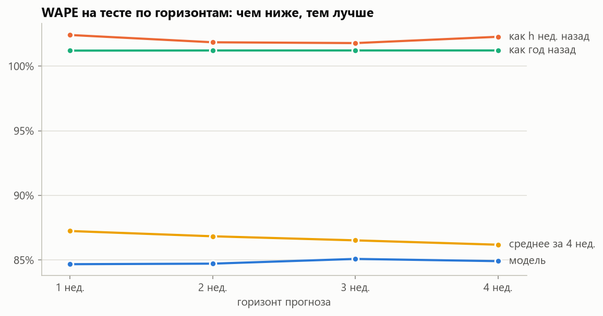
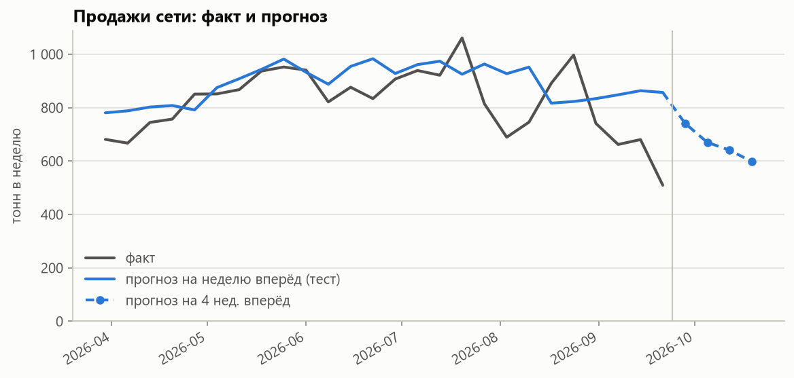
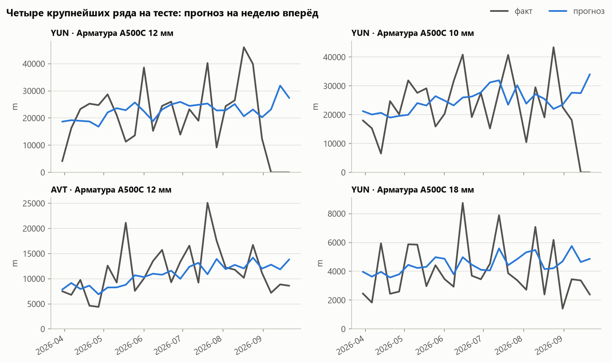

# Анализ и прогнозирование продаж металлоторговой компании

Проект начинался как моя выпускная квалификационная работа 2024 года: настольное приложение,
которое строит прогнозы выручки и продаж металлопроката. Сейчас я развиваю его дальше:
строю реалистичную модель учётной системы сети металлобаз и решаю на ней задачу
прогнозирования спроса.

## Дипломная работа

| Тема | «Разработка приложения для анализа и прогнозирования продаж организации» |
|---|---|
| Вид работы | Выпускная квалификационная работа (бакалаврская работа) |
| Вуз | ФГБОУ ВО «Тольяттинский государственный университет» |
| Кафедра | «Прикладная математика и информатика» |
| Направление | 09.03.03 Прикладная информатика, профиль «Разработка социальных и экономических информационных систем» |
| Автор | Д.В. Логинов, группа ПИб-2004б |
| Руководитель | канд. экон. наук, доцент Т.А. Раченко |
| Год | 2024, Тольятти |

Предметная область работы — ООО «Металл-Маркет», оптовая и розничная торговля металлопрокатом
в Самаре и Тольятти. В работе:

- построены модели бизнес-процесса «Анализ и прогнозирование продаж» в нотации IDEF0 (AS-IS и TO-BE)
  и оценён эффект автоматизации: 10 человеко-часов вместо 35 на тот же объём аналитической работы;
- сформулированы функциональные и нефункциональные требования, спроектированы диаграмма классов
  и диаграмма вариантов использования, выбрана СУБД (MySQL);
- разработано приложение на Python: данные о продажах загружаются из MySQL, категориальные признаки
  кодируются One-Hot, модель случайного леса (scikit-learn) прогнозирует показатели, а интерфейс
  на customtkinter формирует отчёты с графиком и текстом — о выручке, о продажах и по пяти категориям
  товаров на 3, 6 или 12 месяцев.

## Новая версия

### Данные

Модель учётной системы сети из шести металлобаз в PostgreSQL: каталог, клиенты, поставщики,
цены, заказы, поставки, перемещения между базами и движение товаров по складам.

> **Данные синтетические.** Структура сети, ассортимент и услуги смоделированы по публичной
> информации о компании из дипломной работы. Объёмы продаж, клиенты, цены, поставщики и остатки
> вымышлены и не являются данными ООО «Металл-Маркет».

| Период | октябрь 2021 — сентябрь 2026 |
|---|---|
| Ассортимент | 927 позиций в 62 категориях: черный и оцинкованный прокат, трубы, сетки, метизы, фитинги, нержавейка, цветной металл, готовые изделия |
| Клиенты | около 29 тыс.: частные лица, мелкие строители, строительные компании, производства, перепродавцы |
| Заказы | около 250 тыс. заказов и 940 тыс. строк, около 155 тыс. т металлопроката |

В данных есть то, с чем сталкивается реальная металлоторговля: строительная и дачная
сезонность, недельный ритм, зависимость спроса от цен на металл, крупные разовые закупки
юрлиц, совместные покупки товаров, дефицит и затоваривание, ввод и вывод позиций
из ассортимента, открытие новой точки и сезонно работающая база.
Подробнее о модели данных — в [docs/database.md](docs/database.md).

### Задачи

- [x] Модель данных учётной системы в PostgreSQL
- [x] Датасет в CSV — [data/](data/README.md)
- [x] Базовая модель прогноза спроса по позициям, базам и неделям на 1–4 недели
- [ ] Улучшение прогноза: учёт дефицита, цены, иерархия категорий, спрос юрлиц

## Прогноз спроса

Прогноз строится для каждой пары «база × позиция» на 1–4 недели вперёд, по отдельной
модели на горизонт. Всего 3 347 рядов, 260 полных недель с октября 2021 по сентябрь 2026.

### Данные и признаки

Данные читаются из базы или из датасета в CSV (`storage`), предобработка
(`forecasting/preprocessing.py`) собирает недельную панель и признаки:

- ряд существует с появления позиции на базе до её вывода из ассортимента, недели без продаж — нули
  (таких больше половины);
- неделя, когда на базе не было ни одной продажи, считается закрытой и в обучение не входит;
- признаки из истории продаж — только по неделям, известным на момент прогноза:
  лаги, средние за 4, 13 и 26 недель, доля недель с продажами, продажи год назад;
- календарь целевой недели (сезонность, рабочие дни) и справочники (категория, формат базы, единица).

### Модель

Градиентный бустинг (`HistGradientBoostingRegressor` с пуассоновской функцией потерь)
по продажам, нормированным на средние продажи ряда за 26 недель: ряды отличаются по масштабу
на порядки (метры арматуры и штуки метизов), и без нормировки одна модель работает хуже
простых ориентиров.

Выборка делится по времени: обучение — до декабря 2025, валидация для ранней остановки —
13 недель до конца марта 2026, тест — последние 26 недель (30.03–27.09.2026).
Сохраняется модель, переобученная на всех неделях.

Модель сравнивается с тремя наивными прогнозами — ориентирами, которые она должна обгонять:

| Ориентир | Прогноз на неделю T |
|---|---|
| как h недель назад | продажи последней известной недели |
| как год назад | продажи той же недели год назад |
| среднее за 4 недели | средние продажи за 4 последние известные недели |

### Метрики

Ошибка считается по каждой строке теста — ряду и неделе — **в килограммах**: позиции продаются
в метрах, штуках, листах и рулонах, и без пересчёта ошибка по арматуре в метрах заглушила бы всё
остальное. Обозначения: y — фактические продажи, ŷ — прогноз, n — число строк.

| Метрика | Формула | Что показывает |
|---|---|---|
| **MAE** | Σ&#124;ŷ − y&#124; / n | средняя ошибка в кг на ряд в неделю; понятна, но зависит от масштаба |
| **RMSE** | √(Σ(ŷ − y)² / n) | то же, но сильнее штрафует крупные промахи — например, пропущенный заказ юрлица на несколько тонн |
| **WAPE** | Σ&#124;ŷ − y&#124; / Σy | сумма ошибок как доля от объёма продаж; главная метрика — сопоставима между горизонтами и группами товаров |
| **Bias** | Σ(ŷ − y) / Σy | систематическое смещение: больше 0 — прогноз завышен, меньше 0 — занижен. Для запасов важно отдельно от точности: завышение ведёт к затовариванию, занижение — к дефициту |
| **R²** | 1 − Σ(ŷ − y)² / Σ(y − ȳ)² | доля разброса продаж, объяснённая прогнозом: 0 — не лучше среднего, 1 — идеально |

MAPE (средняя относительная ошибка) не используется: в половине строк продажи равны нулю,
деление на них делает метрику бесконечной, а на малых продажах она раздувается от ошибки в одну штуку.

### Результаты

Тест, прогноз на неделю вперёд:

| | MAE, кг | RMSE, кг | WAPE | Bias | R² |
|---|---:|---:|---:|---:|---:|
| **модель** | **219,5** | **678,1** | **84,7 %** | +8,3 % | **0,54** |
| как неделю назад | 265,5 | 896,5 | 102,4 % | +0,7 % | 0,20 |
| как год назад | 262,3 | 902,5 | 101,2 % | −3,8 % | 0,19 |
| среднее за 4 недели | 226,2 | 717,0 | 87,2 % | −0,1 % | 0,49 |

WAPE по горизонтам — модель лучше ориентиров на каждом:

| Горизонт | Модель | Как h недель назад | Как год назад | Среднее за 4 недели |
|---|---:|---:|---:|---:|
| 1 неделя | **84,7 %** | 102,4 % | 101,2 % | 87,2 % |
| 2 недели | **84,7 %** | 101,8 % | 101,2 % | 86,8 % |
| 3 недели | **85,1 %** | 101,8 % | 101,2 % | 86,5 % |
| 4 недели | **84,9 %** | 102,3 % | 101,2 % | 86,2 % |



WAPE около 85 % выглядит большим, но это ошибка по отдельной позиции на отдельной базе за неделю:
спрос там прерывистый, а заметная часть объёма — крупные разовые заказы юрлиц, которые
по истории не предсказать. Если сложить прогнозы по всей сети, недельная ошибка — 12,5 %:





### Ограничения

- **Прогноз завышен на 8 %.** Отчасти это особенность теста: модель прогнозирует спрос, а факт —
  это продажи, и когда товар заканчивается, продажи падают до нуля. Так, у двух крупнейших рядов
  (арматура 10 и 12 мм на Юнгородке) остаток кончился в начале сентября, а всего в последние
  две недели теста без остатка было около 500 рядов. Учёт дефицита — следующий шаг.
- **На уровне сети смещение накапливается.** По сумме сети наивный прогноз «как неделю назад»
  точнее (недельная ошибка 9,4 % против 12,5 %): ошибки отдельных рядов в сумме гасятся,
  а смещение — нет.
- **Рулоны и листы.** По ним WAPE около 110 %: продажи редкие и крупные.

## Структура репозитория

```
src/
└── sales_analytics/              устанавливаемый пакет (импорт: sales_analytics.*)
    ├── config.py                 настройки из .env: DB_*, DATASET_DIR, OUTPUT_DIR (pydantic-settings)
    ├── exceptions.py             SalesAnalyticsError и производные
    ├── storage/                  учётная система в PostgreSQL
    │   ├── sql/tables.sql        таблицы, индексы и представления
    │   ├── schema.py             create_tables()
    │   ├── postgres.py           connect() — подключение с параметрами из .env, create_database()
    │   ├── entities.py           датаклассы: Branch, Product, DemandData
    │   ├── repository.py         load_demand_data() из базы, load_demand_data_csv() из датасета
    │   ├── export.py             export_dataset() — выгрузка таблиц в CSV
    │   └── __main__.py           точка входа: роль и база, таблицы, выгрузка датасета
    └── forecasting/              прогноз спроса
        ├── preprocessing.py      недельная панель и признаки: DemandData -> TrainingSet
        ├── model.py              обучение, метрики, сохранение, прогноз
        ├── report.py             графики
        └── __main__.py           точка входа: train, predict, report
infra/docker-compose.yml          PostgreSQL в контейнере
data/                             датасет: таблицы учётной системы в CSV
docs/
├── database.md                   описание модели данных
└── images/                       графики для README
output/                           модели, прогнозы и выборки (создаётся при запуске, не хранится в git)
```

## Запуск

Нужен Python 3.13:

```bash
python -m venv .venv
.venv/Scripts/python -m pip install -e .        # в Linux/macOS: .venv/bin/python
cp .env.example .env
```

### Прогноз на датасете

PostgreSQL не нужен: данные читаются из `data/`.

```bash
python -m sales_analytics.forecasting train --data data                # обучение на 1–4 недели, около 10 минут
python -m sales_analytics.forecasting train --data data --horizon 1    # только на неделю вперёд
python -m sales_analytics.forecasting predict --data data              # прогноз после конца данных
python -m sales_analytics.forecasting report                           # графики в docs/images
```

Что сохраняется в `output/`:

| Файл | Содержание |
|---|---|
| `models/demand_h{h}.joblib` | модель на горизонт h |
| `models/demand_h{h}.json` | описание: признаки, периоды, параметры, метрики |
| `models/demand_h{h}_test.csv.gz` | прогнозы модели и ориентиров на тесте |
| `forecasts/forecast_{неделя}.csv` | прогноз по базам и позициям: в единицах товара и в кг |
| `training/training_h{h}.csv.gz` | выборка для обучения — с флагом `train --save-data` |

### База данных

Нужен PostgreSQL 15+ — установленный или в Docker, пароль указывается в `.env` (`DB_PASSWORD`).

```bash
docker compose --env-file .env -f infra/docker-compose.yml up -d   # PostgreSQL в контейнере
python -m sales_analytics.storage init                             # или роль и база на установленном PostgreSQL
python -m sales_analytics.storage create --yes                     # таблицы
python -m sales_analytics.storage export                           # выгрузка таблиц в data/
```

Без `--data` команды `train` и `predict` читают данные из базы.

## Технологии

| | 2024 | Новая версия |
|---|---|---|
| Язык | Python 3.7 | Python 3.13 |
| СУБД | MySQL | PostgreSQL 17 |
| Анализ данных | pandas, scikit-learn | pandas, NumPy, scikit-learn |
| Графики | matplotlib | matplotlib |
| Конфигурация | — | `.env` + pydantic-settings |
