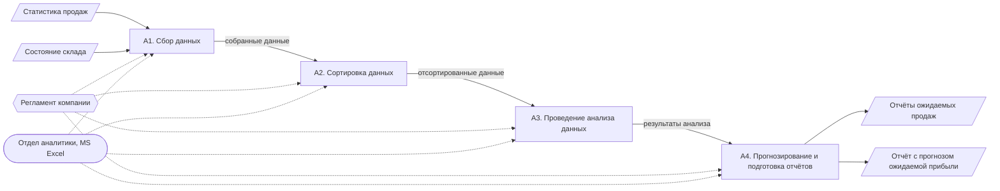
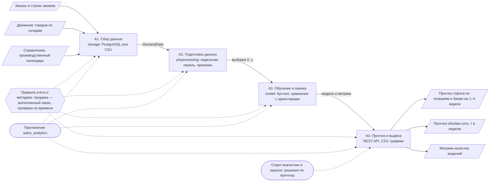
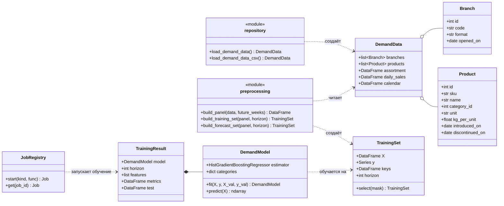
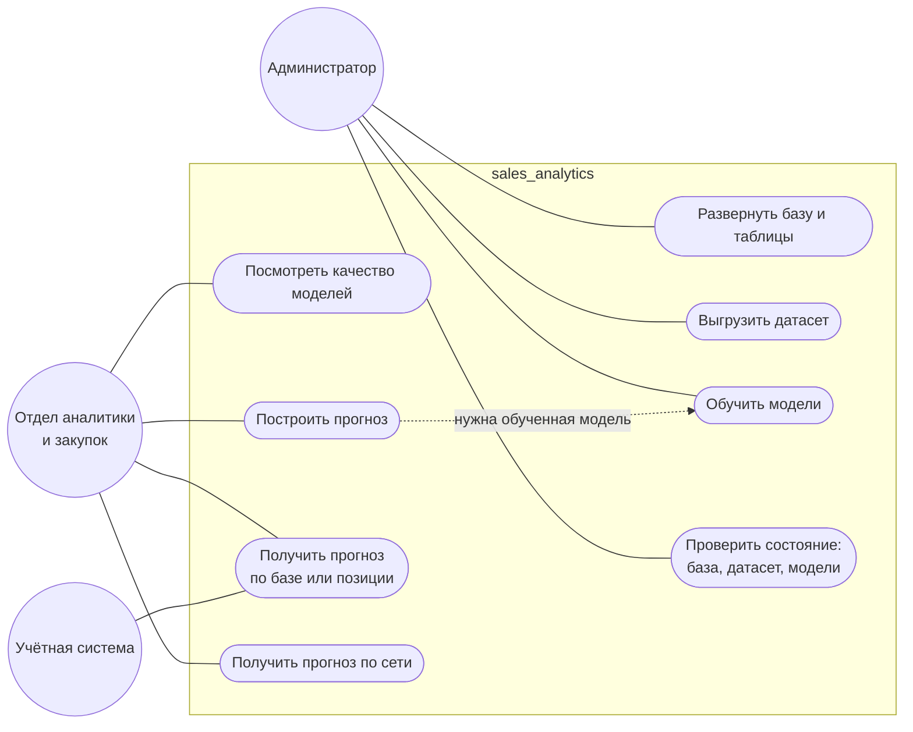

# Дипломная работа 2024 года

> **Этот файл — не текст выпускной квалификационной работы.** Это пересказ её частей,
> относящихся к проекту, с изменениями под текущую версию: схемы перерисованы под нынешнюю
> архитектуру, решения, пересмотренные с тех пор, отмечены, и к каждому добавлено, как оно
> выглядит сейчас и почему. Учебные определения (что такое UML, элементы IDEF0, виды связей
> на диаграмме классов) опущены. Список литературы работы — в [references.md](references.md#литература-дипломной-работы-2024-года). Оригинал работы хранится в вузе.

| Тема | «Разработка приложения для анализа и прогнозирования продаж организации» |
|---|---|
| Вид работы | выпускная квалификационная работа (бакалаврская работа) |
| Вуз, кафедра | ТГУ, «Прикладная математика и информатика» |
| Направление | 09.03.03 Прикладная информатика, профиль «Разработка социальных и экономических информационных систем» |
| Автор | Д.В. Логинов, группа ПИб-2004б |
| Руководитель | канд. экон. наук, доцент Т.А. Раченко |
| Год | 2024 |

## Цель и задачи

**Объект исследования** — разработка и интеграция инструментов анализа данных в информационную
систему организации. **Предмет** — проект реализации и интеграции таких инструментов
в ИТ-инфраструктуру организации.

**Цель** — спроектировать и разработать приложение, использующее современные инструменты
для анализа и прогнозирования продаж организации.

**Актуальность** — конкурентоспособность торговой компании зависит от того, насколько быстро
и точно она понимает, что и сколько будет продано, а ручной анализ в электронных таблицах
занимает много времени и плохо масштабируется.

Задачи работы:

1. дать характеристику организации;
2. исследовать бизнес-процесс анализа и прогнозирования продаж;
3. сформулировать требования к приложению и выбрать средства разработки;
4. спроектировать логическую модель приложения;
5. разработать и протестировать приложение;
6. оценить эффективность приложения.

Новая версия проекта решает те же задачи, но меняет постановку: вместо месячной выручки
по категориям — недельный спрос по позициям и складам. Почему — в [task.md](task.md#почему-именно-так).

## Глава 1. Предметная область

### Организация

ООО «СМЦ «Металл-Маркет» — оптовая и розничная торговля металлопрокатом в Самаре и Тольятти
и услуги металлообработки. Ежедневно заключаются сотни сделок. За анализ продаж и прогнозы
отвечает **отдел аналитики** в составе общекорпоративных служб: он собирает данные, обрабатывает
их, строит прогнозы и готовит отчёты для руководства.

**Сейчас.** Данные компании недоступны, поэтому проект работает на синтетической учётной системе,
устройство которой — сеть из шести металлобаз, ассортимент, услуги — смоделировано по публичной
информации о компании. Подробнее — в [dataset.md](dataset.md).

### Бизнес-процесс «Анализ и прогнозирование продаж»

Процесс описан в нотации IDEF0 [29, 35]. Ниже схемы перерисованы как блок-схемы: прямоугольники — функции,
сплошные стрелки — входы и выходы, пунктирные — управление (регламент) и механизмы
(кто и чем выполняет работу).

**AS-IS — как было в организации:**

| Функция | Содержание |
|---|---|
| A1. Сбор данных | история продаж, состояние склада, ситуация на рынке |
| A2. Сортировка | ручная обработка и проверка данных на точность |
| A3. Анализ | A31 — изучение данных и перевод в числовой вид, A32 — оценка (ручной расчёт), A33 — визуализация |
| A4. Прогноз и отчёты | прогноз и оформление результатов в графическом и текстовом виде |

**TO-BE — в работе 2024 года** механизмом всех функций становилось «Приложение для анализа
и прогнозирования продаж организации», отдел аналитики оставался при сборе данных и отчётах.

**TO-BE — сейчас.** Схема та же, но функции заполнены модулями текущего приложения:

Что изменилось по функциям:

| Функция | 2024 | Сейчас |
|---|---|---|
| A1. Сбор | выгрузка одной таблицы из MySQL | чтение справочников, продаж и движения товаров из учётной системы — [database.md](database.md) |
| A2. Сортировка | ручная проверка, кодирование One-Hot | автоматически: проверка колонок `DemandData`, ограничения `CHECK` в базе, недельная панель — [preprocessing.md](preprocessing.md) |
| A31. Изучение данных | перевод в числовой вид | границы рядов, различие «ноль» и «база закрыта» |
| A32. Оценка | случайный лес | градиентный бустинг, проверка по времени, сравнение с ориентирами — [model.md](model.md) |
| A33. Визуализация | график в окне приложения | графики `report.py`, страница `/docs` API |
| A4. Прогноз и отчёты | отчёты о выручке и продажах на 3, 6, 12 месяцев | прогноз по позициям и базам через REST API — [application.md](application.md) |

### Оценка эффективности

В работе эффект оценивался в логике реинжиниринга бизнес-процессов [31, 33] — коэффициентом
интенсивности труда, то есть человеко-часами на единицу объёма работы:

| Модель процесса | Человеко-часов | Объём работы | Коэффициент |
|---|---:|---:|---:|
| традиционные методы анализа (AS-IS) | 35 | 100 | 0,35 |
| с приложением (TO-BE) | 10 | 100 | 0,10 |

Вывод работы — процесс с приложением более чем в три раза эффективнее.

**Оговорка.** Это экспертная оценка, а не измерение: замеров времени в организации не проводилось.
Текущая версия проекта оценивает себя иначе — не временем аналитика, а точностью прогноза
по сравнению с простыми правилами, которые не требуют ни модели, ни аналитика
([metrics.md](metrics.md)). Обе оценки отвечают на разные вопросы: первая — сколько работы
снимает автоматизация, вторая — насколько автоматический прогноз лучше наивного.

### Требования

Ниже требования работы и то, как они выполнены в текущей версии.

**Функциональные**

| № | Требование 2024 года | Сейчас | Статус |
|---|---|---|---|
| 1 | собирать данные в блок анализа | `load_demand_data()` из PostgreSQL, `load_demand_data_csv()` из датасета | выполнено |
| 2 | классифицировать, кодировать и нормализовать данные | недельная панель, категориальные признаки без One-Hot, нормировка продаж на масштаб ряда | выполнено |
| 3 | анализировать данные и прогнозировать их | модели на 1–4 недели, сравнение с ориентирами, метрики | выполнено |
| 4 | отчёты: прогноз выручки, общего количества продаж, продаж по категориям | прогноз по позициям и базам в единицах и кг, сводка по сети в тоннах, графики. Выручка не прогнозируется сознательно ([task.md](task.md#спрос-по-позициям-а-не-выручка-по-категориям)); отдельного отчёта по категориям нет, его можно собрать из прогноза по позициям | частично |

**Нефункциональные**

| № | Требование 2024 года | Сейчас | Статус |
|---|---|---|---|
| 1 | доступность для пользователей с разным уровнем навыков | страница `/docs`: любой запрос выполняется из браузера. Графического интерфейса для пользователя без технических навыков нет: потребитель прогноза — другая система | частично |
| 2 | безопасность | параметризованные запросы psycopg, пароль только в `.env` (`SecretStr`), API слушает только 127.0.0.1. Авторизации нет | частично |
| 3 | масштабируемость | одна модель на 3 347 рядов вместо модели на ряд, материализованное представление продаж. Работает в одном процессе, данные в памяти | частично |
| 4 | отказоустойчивость | ошибка задачи не останавливает API и попадает в её статус, ошибки переводятся в HTTP-коды, контейнер базы перезапускается сам. Статусы задач теряются при перезапуске API | частично |
| 5 | совместимость с разными ОС и браузерами | Python и Docker на Windows, Linux, macOS; API доступен любому HTTP-клиенту | выполнено |

Отдельно в работе требовалось использовать последнюю версию языка и проверенные пакеты, защищаться
от SQL-инъекций и иметь возможность быстро перенести приложение на новую машину. Сейчас это
Python 3.13 и зафиксированные версии зависимостей в `pyproject.toml`, параметризованные запросы
и `sql.Identifier` для имён объектов, развёртывание командами `docker compose` и `pip install -e .`
и датасет в CSV, с которым база не нужна.

## Глава 2. Логическое проектирование

### Инструменты

В работе рассматривались библиотеки Python для анализа данных (NumPy, pandas, scikit-learn) [20, 21, 25],
методы временных рядов (ARIMA, экспоненциальное сглаживание, Prophet), регрессионный и кластерный
анализ, библиотеки визуализации и REST API как способ интеграции с системами склада и продаж.

**Сейчас.** Используются NumPy, pandas, scikit-learn и matplotlib. ARIMA и экспоненциальное
сглаживание рассмотрены и отвергнуты для прогноза по позициям — в пользу одной модели
градиентного бустинга на все ряды ([model.md](model.md#выбор-модели)). Интеграция через REST API,
упомянутая в работе как перспектива, реализована — это основная точка входа приложения.

### Диаграмма классов

В работе спроектированы шесть классов (нотация UML [30, 40]):

| Класс 2024 года | Назначение | Чем стал сейчас |
|---|---|---|
| `Sales` — выручка, дата, отзыв | продажи | таблицы `sales_orders` и `sales_order_lines`: продажа — документ со строками. Отзывы убраны: в учётной системе их нет, а для прогноза спроса по позициям они не нужны |
| `Stock` — номенклатура, количество; приход и расход | склад | регистр движения товаров `stock_movements`: приход и расход — движения со знаком, остаток — их сумма ([database.md](database.md#регистр-движения-товаров)) |
| `Data` — общий датафрейм, создание и редактирование | данные для анализа | датакласс `DemandData`: неизменяемый, проверяет колонки при создании. Данные редактируются в учётной системе, а не в приложении |
| `Collector` — нормализация и кодирование | подготовка данных | модуль `preprocessing`: `build_panel()`, `build_training_set()` → `TrainingSet` |
| `Analyzer` (наследник `Collector`) — анализ | модель | `DemandModel` и функция `train()` → `TrainingResult` |
| `Report` (наследник `Analyzer`) — отчёт | отчёт | `forecast()` и `save_forecast()`, эндпоинты `/forecasts`, графики `report.py` |

В 2024 году диаграмма в код не перешла: приложение было написано процедурно. Наследование
`Report` → `Analyzer` → `Collector` при этом выражало не «является», а «выполняется после»,
то есть последовательность шагов. В текущей версии шаги — функции разных модулей, а данные между
ними передаются явными объектами:

Почему так, а не иерархией классов — в [application.md](application.md#почему-так).

### Выбор СУБД

В работе сравнивались Oracle, MySQL и PostgreSQL по десяти критериям: гибкость, эффективность,
нормализация, простота, совместимость, поддержка стандартов, безопасность, структуризация,
открытый код, масштабируемость. Итог — MySQL 10 баллов, PostgreSQL 6, Oracle 5; выбрана MySQL.

**Сейчас выбран PostgreSQL**, и сравнение пересмотрено. Часть оценок 2024 года была спорной:
PostgreSQL получил минус за поддержку стандартов, хотя соблюдает стандарт SQL строже MySQL.
Главное же — изменились требования. Одной таблице с итогами подходила любая СУБД, а учётной
системе нужны материализованные представления, потоковая выгрузка `COPY`, `jsonb` для атрибутов
товаров, проверки `CHECK` и транзакционное изменение схемы. Подробно — в
[database.md](database.md#почему-так).

### Варианты использования

В работе два актёра — администратор (контроль работы приложения, управление данными) и отдел
аналитики (предоставление данных, выбор отчёта, генерация отчёта с графиком и прогнозом);
отдельно упоминалось обучение в реальном времени при поступлении новых данных.

**Сейчас** у приложения появился третий пользователь — другая информационная система,
а обучение запускается по запросу:

Каждому варианту соответствует команда или эндпоинт — см. [application.md](application.md#точки-входа).

## Глава 3. Разработка и тестирование

### Приложение 2024 года

- данные — одна таблица MySQL из 10 колонок: месяц, выручка, номенклатура, отзыв, продажи
  пяти категорий (трубы, конструкции, метизы, нержавейка, сетка) и общее количество;
- подключение через MySQL Connector, обработка в pandas, кодирование месяца One-Hot;
- модель — случайный лес scikit-learn (100 деревьев) [25, 41], разбиение на обучение и тест 80/20;
- проверка — средняя абсолютная ошибка (MAE);
- интерфейс на customtkinter: выбор отчёта (выручка, продажи, категория) и срока (3, 6, 12 месяцев),
  отчёт с текстом и графиком.

### Что пересмотрено и почему

| Решение 2024 года | Проблема | Сейчас |
|---|---|---|
| месяц хранится названием без года | порядок месяцев разных лет теряется, модель не знает, что было раньше | дата — календарная, ряд — недельный, с явным порядком ([preprocessing.md](preprocessing.md)) |
| случайное разбиение 80/20 | в обучение попадают месяцы после тестовых: модель «знает» будущее | разбиение по времени: обучение, валидация, тест — последние 26 недель ([model.md](model.md#схема-проверки)) |
| общее количество — сумма продаж пяти категорий, категории среди признаков | при прогнозе количества модель получает ответ в признаках — утечка целевой переменной | признаки только из прошлого, отсутствие утечки проверяется тестом ([testing.md](testing.md#отсутствие-утечки-будущего)) |
| MAE считался по всем строкам, включая обучающие | ошибка на данных, которые модель видела, занижена и ничего не говорит о прогнозе | метрики только на отложенном тесте, пять метрик в килограммах ([metrics.md](metrics.md)) |
| нет ориентиров | неизвестно, лучше ли модель простого правила | три наивных ориентира, модель лучше всех на всех горизонтах |
| 168 строк | для модели по позициям и складам данных нет | учётная система: 5 лет, 927 позиций, 6 баз ([dataset.md](dataset.md)) |
| интерфейс customtkinter | прогноз нельзя забрать из другой системы, окно зависает при расчёте | REST API с фоновыми задачами ([application.md](application.md#почему-rest-api-а-не-настольный-интерфейс)) |

### Тестирование

В работе приложение проверялось функционально: по каждому из четырёх функциональных требований
вручную показывалось, что оно выполняется — данные загружаются, кодируются, прогноз строится,
отчёты формируются.

**Сейчас** проверка автоматическая: 73 юнит-теста на pytest запускаются одной командой
и проверяют не только то, что функции работают, но и методические свойства — отсутствие утечки
будущего, правильность метрик на примерах, посчитанных вручную, разбиение по времени.
Подробно — в [testing.md](testing.md).

## Заключение

Выводы работы 2024 года:

- для повышения эффективности процесса «Анализ и прогнозирование продаж» нужен автоматический
  инструмент с методами машинного обучения;
- спроектированы требования, логическая модель и база данных;
- разработано и функционально протестировано приложение, строящее отчёты о прогнозе выручки и продаж.

Что подтвердилось и что изменилось в текущей версии:

- **Подтвердилось:** автоматизация процесса и машинное обучение для прогноза. Модель
  градиентного бустинга обгоняет все простые ориентиры ([metrics.md](metrics.md#результаты)).
- **Изменилось:** уровень прогноза (позиции и недели вместо категорий и месяцев), СУБД, модель,
  способ проверки качества и интерфейс. Одна из главных причин — методические ошибки проверки,
  описанные выше: без разбиения по времени и отложенного теста точность модели 2024 года
  оценить было нельзя.
- **Осталось открытым:** учёт дефицита, интервалы прогноза и проверка на нескольких окнах
  ([model.md](model.md#что-дальше)).
